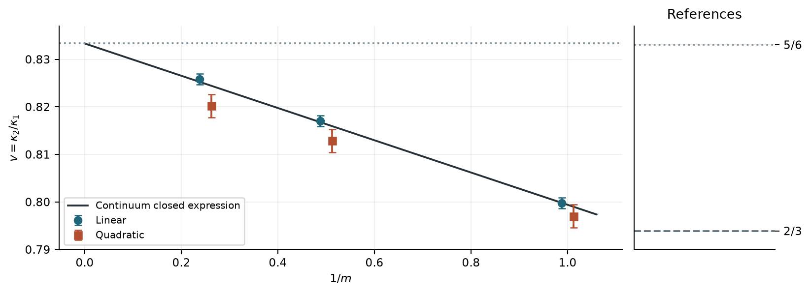

# Partial ports and crossing fluctuations in the three-dimensional Lorentz mirror model

Pure retroreflection admits an exact reduction to selected connections in a
fully open reference graph. Applying established diffusive counting theory
then gives a conditional, parameter-free stripe prediction. Two independent
stripe data sets support layout dependence and half-open absolute ratios
within statistical errors and the spread of two prescribed extrapolations.
This is a specific reduction and numerical test, not a new general counting
framework or a proof of the microscopic continuum limit.

> **Not peer reviewed. Local release candidate 1.0.0-rc1, 1 November 2026.**
> Author: **JJIN HANZHE**. The author supplied directional guidance.
> **Opus 5.5** proposed the initial plan; **GPT-6 Astra (max)** performed later
> research design, simulations, analysis, derivations and writing. System
> names are supplied by the author. Checks use separate implementations,
> exact identities and independent numerical calculations. There has been
> **no external human expert review**.

Read the [report](paper/paper.pdf) and [complete supplement](paper/sm.pdf).

## Key results

All ± values below are one bootstrap standard error. The covariance target's
separate deterministic allowance is not a statistical error or a rigorous
physical error bound. Values are sourced from
[number_sources.csv](results/number_sources.csv), which records result files
and JSON pointers.

| Observable | Rule | Target | Linear extrapolation | Quadratic extrapolation |
|---|---|---:|---:|---:|
| Half-open, 1 stripe(s) | Joint | 0.799413778 | 0.799752 ± 0.001116 | 0.797022 ± 0.002399 |
| Half-open, 2 stripe(s) | Joint | 0.816372255 | 0.817086 ± 0.001130 | 0.812874 ± 0.002408 |
| Half-open, 4 stripe(s) | Joint | 0.824852794 | 0.825861 ± 0.001150 | 0.820215 ± 0.002456 |
| Four minus one stripes | Joint | 0.025439016 | 0.026719 ± 0.002106 | 0.025149 ± 0.005325 |
| Full-open cube | standard | 2/3 (original null) | 0.670186 ± 0.002851 | 0.666812 ± 0.007241 |
| Full-open cube | orthogonal | 2/3 (original null) | 0.669290 ± 0.003060 | 0.669803 ± 0.006917 |
| Gapped covariance, wall A | standard | 0.513859 (allowance 0.001872) | 0.517004 ± 0.001513 | 0.514276 ± 0.003236 |
| Gapped covariance, wall A | orthogonal | 0.513859 (allowance 0.001872) | 0.514532 ± 0.001441 | 0.514961 ± 0.003056 |
| Gapped covariance, wall B | standard | 0.513859 (allowance 0.001872) | 0.517263 ± 0.001422 | 0.517552 ± 0.003278 |
| Gapped covariance, wall B | orthogonal | 0.513859 (allowance 0.001872) | 0.517928 ± 0.001388 | 0.517246 ± 0.002997 |
| Retroreflecting count | standard | 2/3 (original null) | 0.822143 ± 0.002181 | 0.822773 ± 0.004819 |
| Retroreflecting count | orthogonal | 2/3 (original null) | 0.818848 ± 0.002116 | 0.813176 ± 0.004597 |

The stripe targets lie between the linear and quadratic joint estimates.
Their spreads are about 0.0027, 0.0042 and 0.0056 (0.3–0.7%); these are
descriptions of extrapolation sensitivity, not confidence intervals.
The layout contrast rejects zero under its fixed rules.
The original retroreflecting count rejects 2/3. Its later, exploratory
comparison to the two-stripe target 0.816372255 ranges from −0.70 to 2.65
standard errors. Reconstructing the full-face count from the same samples
gives intercepts 0.66650–0.67085; this is not another independent experiment.
The supplement includes all original 30 decisions and 120 fits.

## What is established, inherited and conditional

- **Exact in the model:** the pure-retroreflection pathwise reduction and
  finite-graph port identities.
- **Inherited theory:** the multiterminal diffusive counting framework and
  general boundary variance functional. Its generating function matches
  under a change of counting variable; this is not a microscopic
  identification of electronic time statistics and mirror sample statistics.
- **Derived within that theory:** the three-dimensional stripe Fourier
  expression and its polylogarithm form, retaining the small exponential
  correction in numerical targets.
- **Locally preregistered numerical tests:** the layout contrast and fresh
  half-open absolute ratios, both rules and both extrapolations; original
  full-open and gapped covariance tests; rejection of 2/3 for retroreflection.
- **Exploratory:** the retrospective reconstruction, quarter-open geometries,
  auxiliary third cumulants and spectra, and unfinished finite-size matching.

Partial-boundary counting has a direct two-dimensional loop-model precedent
in [Morin-Duchesne and Jacobsen](https://doi.org/10.21468/SciPostPhys.4.6.034).
Boundary channel correlations also appear in
[Gu, Schaeffer and Hao](https://arxiv.org/abs/2609.23244v1).
Within the literature we searched, this report's contribution is limited to
the specific pure-retroreflection reduction, three-dimensional stripe formula
and numerical tests. See [related work](docs/RELATED_WORK.md).

## Limitations and open questions

The two extrapolation forms disagree more than the linear statistical errors.
Older standard-rule data have an upward common offset; pooled all-size linear
fits retain it. Exploratory quarter-open absolute ratios are about 0.5% above
the targets. Independent single-stripe third-cumulant estimates lie on opposite
sides of theory. Five covariance-identity tests, fourth cumulants, some
fit-quality checks and the earlier finite-precision baseline remain unresolved.

A complete bulk and boundary finite-size theory with bounded physical
remainder was not obtained. Further matching research is stopped. The
proposed later confirmation was never frozen or sampled.
There is no rigorous microscopic continuum limit or confirmation for
arbitrary opening fraction.

Analysis plans and seeds were fixed and hashed locally before the respective
confirmation samples, **without third-party timestamps or registration**.
Readers can verify contents and hashes but cannot independently verify
the claimed historical freeze times.

## Repository contents

| Directory | Contents |
|---|---|
| paper/ | English report, supplement, LaTeX, bibliography, generated figures and tables |
| results/ | Preserved analysis summaries, bootstrap outputs, source and numeric registries |
| data/ | All 3,668,750 stripe environments as compact integer observations |
| preregistration/ | Original plans, sample allocations, original seeds and hashes |
| code/ | Portable sampling and statistical cores; deterministic theory checks |
| scripts/ | Verification, figure/table creation, analysis replay, seed replay, PDF build |
| docs/ | History, methods, related-work scope and reproduction limits |

Full raw blocks, third-party papers, internal Chinese records and machine
logs are not included. No environment was removed from the compact stripe
data. Earlier geometry tests are supplied as saved summaries, not all their
raw environments. The source manifest records copied code and data origins;
changes are restricted to portable imports, module extraction and the
equivalent integer-feature input adapter.

## Reproduce

Use Python **3.12**. A new environment with the exact versions in
requirements.txt was tested on Windows, including NumPy 2.4.4 and Numba
0.67.0. Run from the repository root:

    python -m venv .venv
    .venv/Scripts/python -m pip install -r requirements.txt

Activate that environment or use its Python executable in the following:

1. **Figures, tables, hashes and theory** — usually under one minute after
   installation:

       python scripts/verify_all.py

   Rebuilds every supplied table and figure, checks numeric-source values
   (exact deterministic values; floating tolerance 1e-12), verifies input
   hashes, and independently checks the continuum kernel and stripe formula.

2. **Replay both primary analyses** — about 2–3 minutes on the tested machine:

       python scripts/reanalyse.py --stage both

   Uses all compact environments and the original bootstrap seeds, all
   fit forms and gates. The clean-environment run checked 349,312 numbers
   and found maximum difference **0**. The stored timing was approximately
   138.5 CPU seconds and 140.4 wall seconds.

3. **Regenerate original samples** — the default four-block check takes
   seconds after compilation; the full stripe collection takes much longer:

       python scripts/regenerate.py

   The four checked blocks contain 4,500 environments; every value and
   original array-file hash matched. To regenerate all recorded stripe blocks:

       python scripts/regenerate.py --stage both --all-recorded-blocks

   This uses only the archived physical seeds, in their original blocks.
   Historical sampling costs were approximately **2.39 CPU hours** for the
   layout data and **16.30 CPU hours** for the absolute-ratio data; these are
   recorded costs, not promises for other hardware. Entire-stage ledgers,
   including analysis and allowances, were 2.55 and 16.64 CPU hours.
   See [resources.json](results/resources.json).

To compile the PDFs, install a LaTeX distribution with pdflatex and bibtex:

    python scripts/build_paper.py

The verification results do not test other operating systems, other Numba
versions, every original-geometry raw block or the unfinished matching program.
Compact records alone do not contain all auxiliary higher-source information.
Details are in [METHODS_NOTES.md](docs/METHODS_NOTES.md).

## Citation and licenses

Please cite **JJIN HANZHE (2026), Partial ports and crossing fluctuations in the
three-dimensional Lorentz mirror model, version 1.0.0-rc1**, and state that it
is an unreviewed research report. [CITATION.cff](CITATION.cff) retains the full
supplied name as one citation string; no given/family-name order is inferred.
No DOI or public repository URL has been assigned.

[Code: MIT](LICENSE). [Manuscript, figures, documentation and data: CC BY 4.0](LICENSE-DOCS).
External dependencies retain their own licenses. AI systems are disclosed
as tools and are not listed as authors.

## Research history

[HISTORY.md](docs/HISTORY.md) records the progression, failed and inconclusive
tests, later corrections and the decision to stop further research.
This directory is a local candidate for review; it has not been uploaded.
